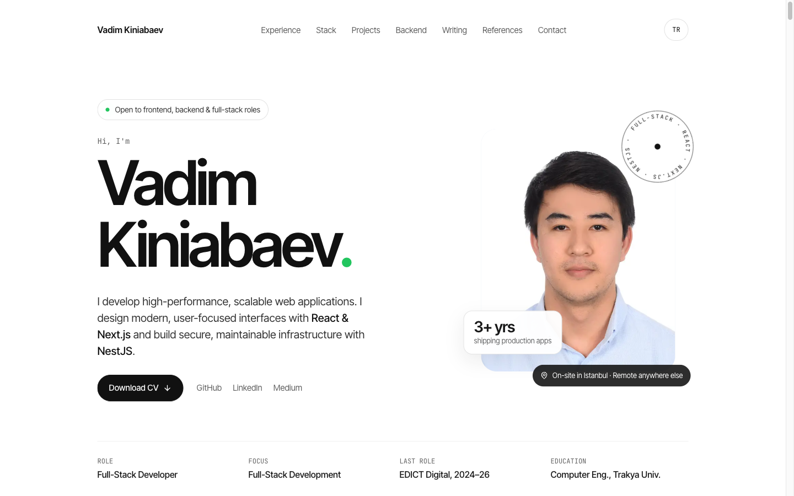
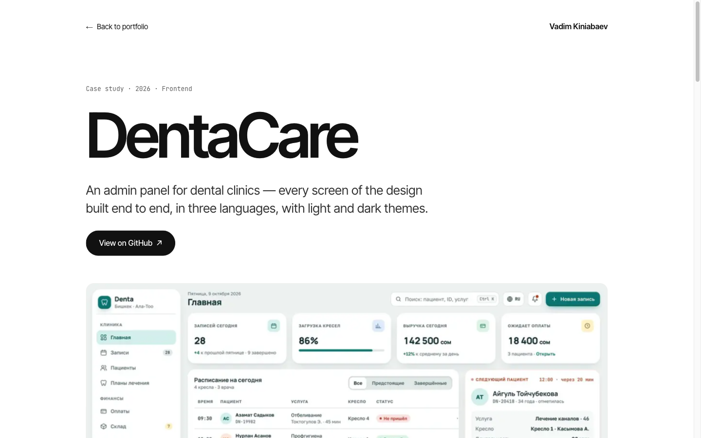
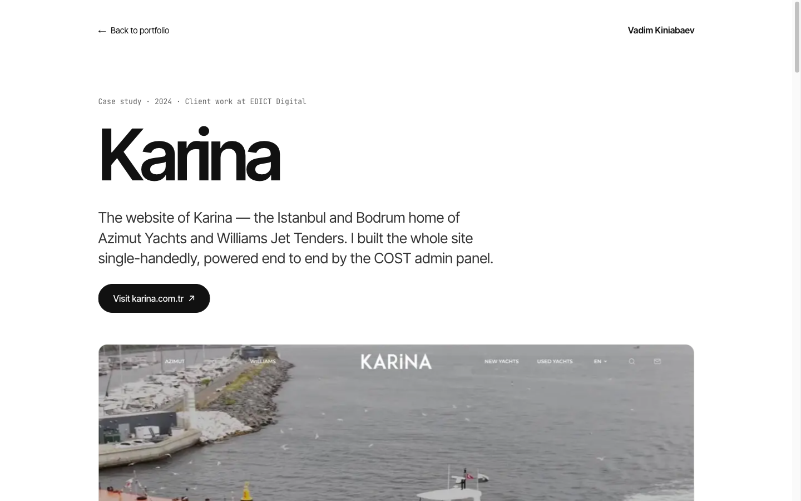

# Vadim Kiniabaev — Portfolio

Personal portfolio of **Vadim Kiniabaev**, full-stack developer (React · Next.js · NestJS).
Bilingual (English / Turkish), fully static, with in-depth case studies of selected projects.

**Live:** https://myportfolio-kappa-dusky-40.vercel.app



## Screenshots

| Case study — DentaCare                                             | Case study — Karina Yachts                                   |
| ------------------------------------------------------------------ | ------------------------------------------------------------ |
|  |  |

## Lighthouse

### Home — `/`

**Desktop**


**Mobile**


### Case study — `/projects/dentacare`

**Desktop**


**Mobile**


### Case study — `/projects/karina`

**Desktop**


**Mobile**


## Tech stack

[](#tech-stack)

| Area      | Technology                                                                                      |
| --------- | ----------------------------------------------------------------------------------------------- |
| Framework | [Next.js 16](https://nextjs.org) (App Router, Cache Components, Partial Prefetching, Turbopack) |
| UI        | [React 19](https://react.dev), Server Components                                                |
| Language  | [TypeScript 5](https://www.typescriptlang.org)                                                  |
| Styling   | [Tailwind CSS 4](https://tailwindcss.com)                                                       |
| Icons     | [Lucide](https://lucide.dev)                                                                    |
| Fonts     | Inter Tight & JetBrains Mono via `next/font`                                                    |
| Tooling   | [Bun](https://bun.sh), ESLint 9, Prettier (sorted imports), Husky git hooks                     |
| Hosting   | [Vercel](https://vercel.com)                                                                    |

## Features

- **Bilingual** — English at `/`, Turkish at `/tr`; all copy lives in JSON under `src/data/{en,tr}`.
- **Case studies** — statically generated pages at `/projects/[slug]` (DentaCare, Karina Yachts) built from JSON content.
- **Fully static** — every route is prerendered; no client-side data fetching.
- **Accessible & responsive** — semantic markup, keyboard-friendly navigation, layouts from 360 px up.
- **Optimised assets** — `next/image` and self-hosted fonts keep CLS at 0.

## Project structure

```
app/                    Routes (/, /tr, /projects/[slug], error, loading, not-found)
src/
  components/
    home/               Home page sections (hero, experience, stack, projects…)
    case-study/         Case study layout and section components
    ui/                 Shared primitives (Chip, PillLink, Terminal, Timeline…)
  data/                 Content as JSON (en, tr, case-studies, profile)
  lib/                  Content loaders and route helpers
  types/                Shared TypeScript types
public/images/          Project screenshots and portrait
public/screenshots/     README screenshots
```

## Getting started

Requires [Bun](https://bun.sh) 1.4+.

```bash
bun install
bun dev            # http://localhost:3000
```

| Script           | Description                |
| ---------------- | -------------------------- |
| `bun dev`        | Start the dev server       |
| `bun run build`  | Production build           |
| `bun start`      | Serve the production build |
| `bun run lint`   | Lint with ESLint           |
| `bun run format` | Format with Prettier       |

Commit messages are checked by a Husky hook and must follow
`type:[branch][developer]: description`, e.g. `feat:[master][Vadim]: add contact form`.

## Deployment

Deployed on [Vercel](https://myportfolio-kappa-dusky-40.vercel.app). To deploy manually:

```bash
vercel --prod
```

## Contact

- Email: [vkiniabaev@gmail.com](mailto:vkiniabaev@gmail.com)
- GitHub: [@thekinv21](https://github.com/thekinv21)
- LinkedIn: [vadimkiniabaev](https://www.linkedin.com/in/vadimkiniabaev)
- Medium: [@thekinv21](https://medium.com/@thekinv21)
